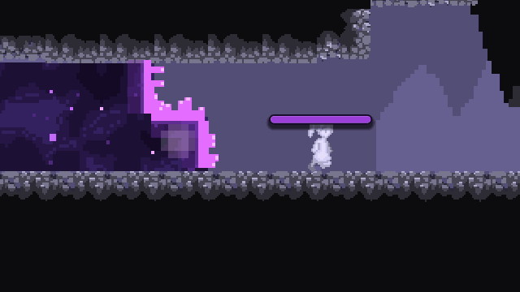

# Lost Soul

**[▶ Play in the browser](https://aarmert.github.io/lost-soul/)** · [Windows download](https://github.com/aarmert/lost-soul/releases/latest/download/LostSoul-windows.zip)

A short, dark pixel-art platformer about a small soul running from a living darkness. Godot 4, made by a
team of four for the KIT Clementine game jam.

## The game

Three levels, played in order:

1. **Forest.** An easy introduction to the movement: jumps, double-jump orbs, dash and vine walls. Each
   street lamp is a checkpoint, and when you reach one the camera shows the next stretch. Watch it: twice the
   right way is something you can only know from that preview.
2. **Cave.** A living darkness spreads through the cave behind you. Hidden triggers speed it up or slow it
   down, and the chase music changes with it, so you can hear how close you are to being caught. Lamps keep
   the darkness out.
3. **Lantern cave.** You find a flashlight with a small battery. Shadows freeze and dissolve in its beam,
   walls of darkness burn away, and some guards can only be pushed back for a moment.

## Who did what

**My part (aarmert):**

- the level design of the cave level,
- the logic of how the darkness spreads and chases the player, written in GDScript
  (`scripts/darkness/Manager_Darkness.gd`),
- the music.

**The rest of the team:**

| | |
|---|---|
| Maya ([Maya-Tukel](https://github.com/Maya-Tukel)) | pixel art |
| Barkın ([reignthevth](https://github.com/reignthevth)) | programming, design of the first level |
| Alparslan ([AlparslanSemiz](https://github.com/AlparslanSemiz)) | programming, design of the third level |

**After the jam** I kept working on the game with Claude (Anthropic's AI coding assistant) to make it more
playable: the forest and lantern-cave levels were reworked, the chase was retuned and the darkness got its
creature look, the chase music was extended on top of the original track, and sound effects, menus and
display scaling were added. The jam version is the state of the team repository at commit `679652f`.

## Controls

| Action | Keys |
|---|---|
| Move | A / D or Left / Right |
| Jump | Space |
| Dash | Shift or F |
| Flashlight (last level) | Z |
| Replay the camera preview at a lamp | W or Up |
| Fullscreen | F11 or Alt+Enter |

Orbs: gold lets you jump once more in the air, teal gives you a dash even while dash is on cooldown.

## Running it from source

Open the folder in **Godot 4.6** and press Play (the main scene is `scenes/main_menu.tscn`).

Export presets are not kept in the repository; add a "Windows Desktop" or "Web" preset in the editor and
export from *Project → Export*.

## Repository layout

| Path | Contents |
|---|---|
| `scenes/`, `scripts/` | the game: levels in `scenes/levels/`, player in `scripts/player/`, the cave darkness in `scripts/darkness/` |
| `assets/` | sprites, tilesets, fonts |
| `audio/` | music and sound; the team's jam music is in `audio/jam/`, and `audio/CREDITS.md` explains how the rest was made |
| `shaders/`, `ui/` | shaders and the UI theme |
| `tools/` | scripts that generate the audio and the orb sprites |
| `trials/` | an unfinished extra mode, hidden from the menu |

## Licence and credits

The source code is under the MIT licence (`LICENSE`). Art, music and sound are not covered by it; see
`CREDITS.md` for who made what and for the third-party assets.
